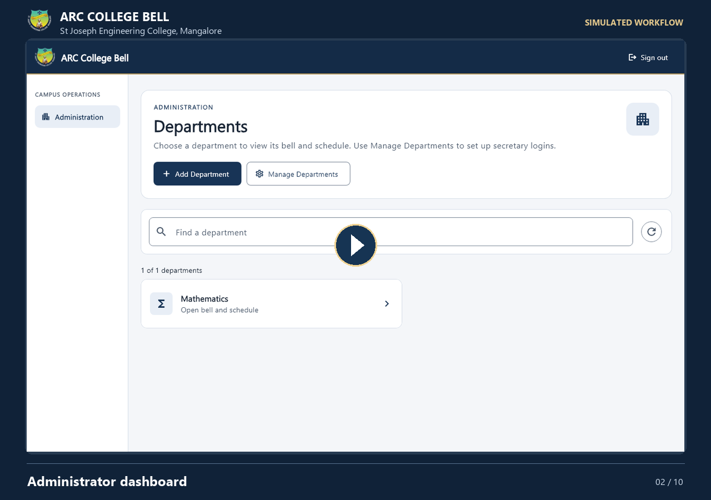
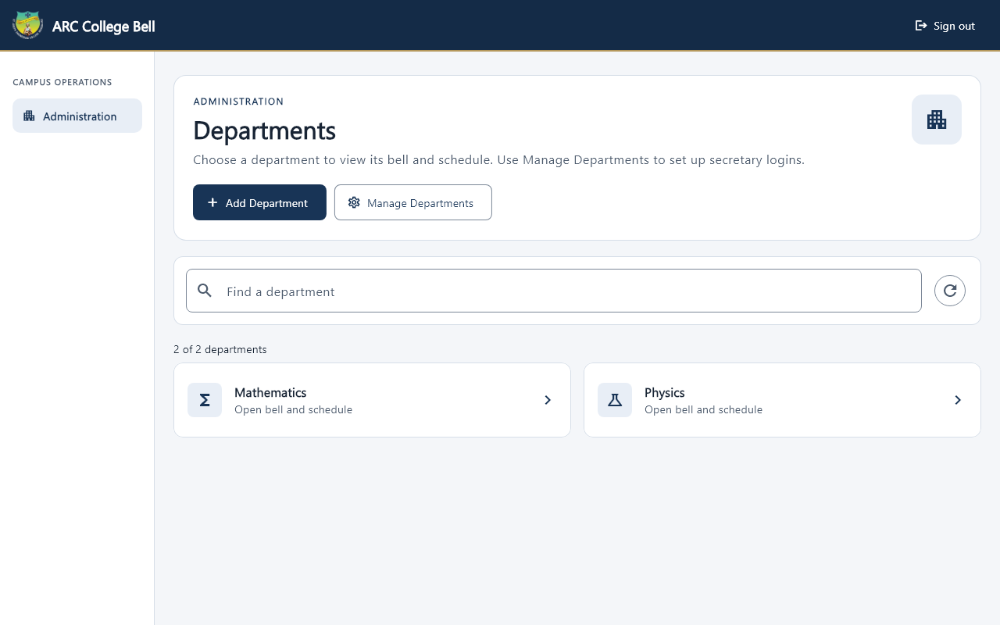
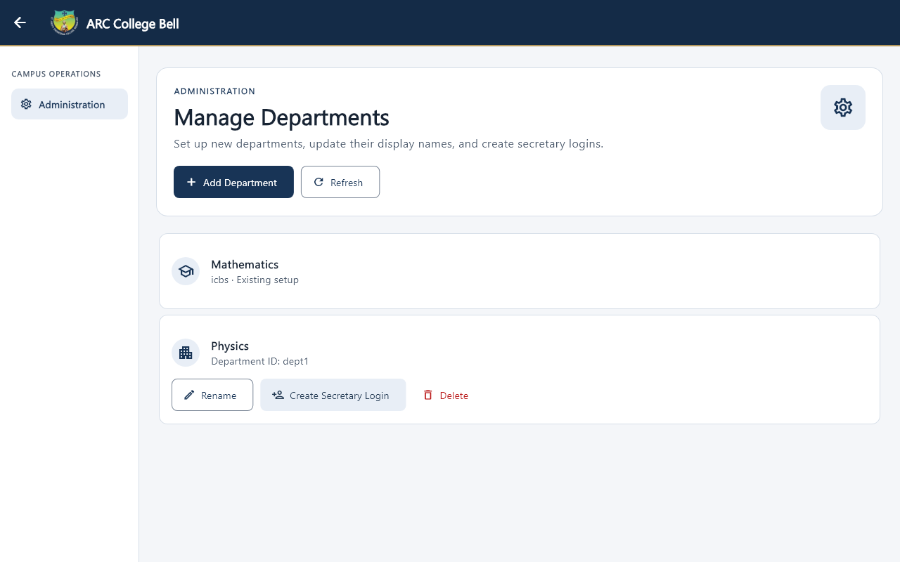
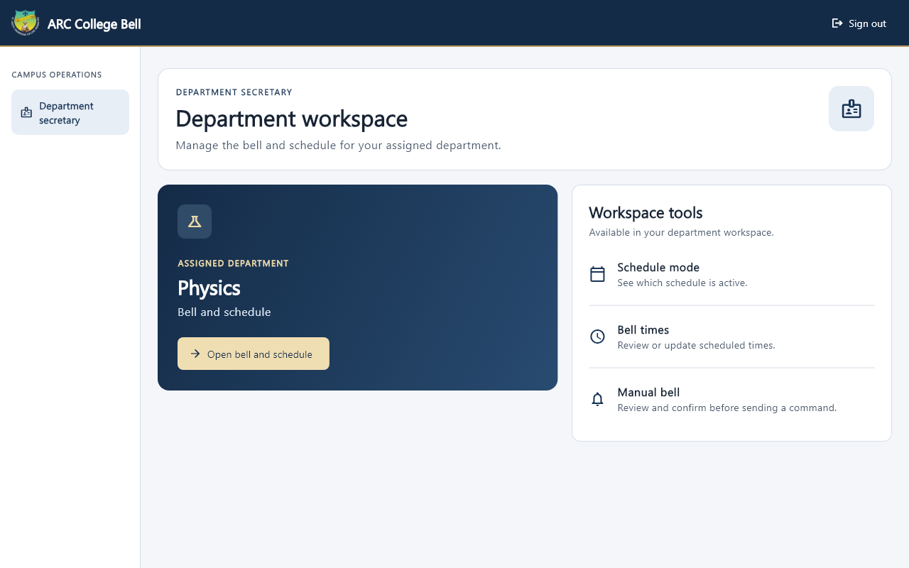
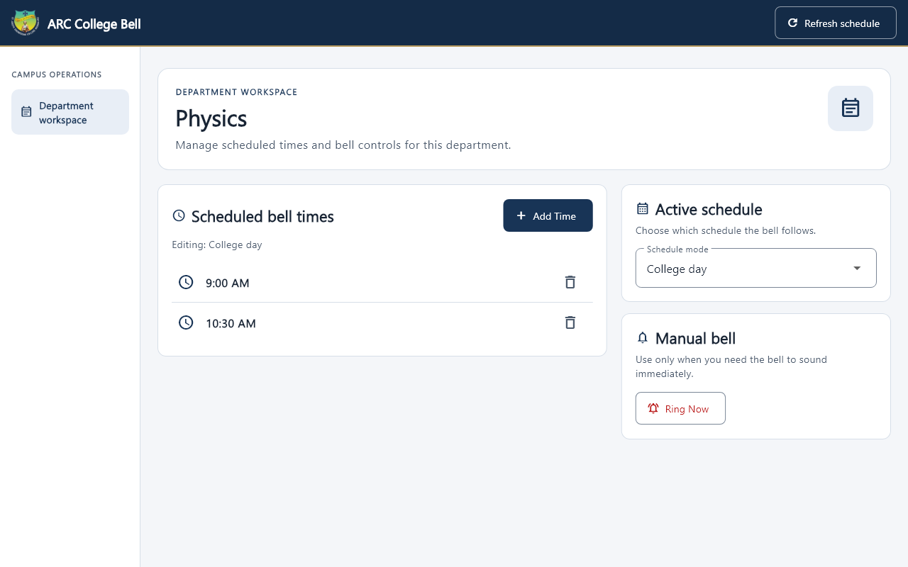
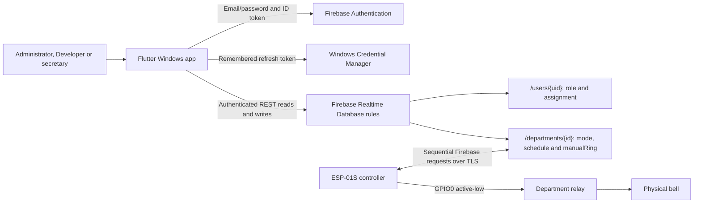

# ARC College Bell

A Windows application and ESP‑01S controller for department bell schedules, implemented at **St Joseph Engineering College, Mangalore**. Staff manage schedules from the desktop. A controller assigned to each equipped department reads that department’s schedule and operates its relay.

## Demo

[](docs/media/arc-college-bell-demo.mp4)

[Download the narrated MP4](docs/media/arc-college-bell-demo.mp4?raw=1) · [Read the transcript](docs/demo-transcript.md)

The walkthrough uses the Flutter screens with simulated departments and synthetic narration. It shows administrator setup, the Physics secretary’s restricted workspace, and the confirmations for deletion and manual ringing. The demo uses sample data and has no connection to a campus bell.

## Staff workflow

| Who | What to do |
| --- | --- |
| Admin or Developer | Sign in to see all departments. Use **Manage Departments** to add a department, rename a department created in the app, or set up its secretary login. Firebase uses IDs such as `dept1`. |
| Admin or Developer | To create a secretary login, enter the email and an initial password. Share the credentials through your institution’s approved channel. The app sends no invitation email. |
| Department secretary | Sign in to see your assigned department. Choose **Open bell and schedule**, select the active schedule, and use **Add Time** to add a bell time. |
| Authorized operator | For an immediate bell, select **Ring Now** and review the department name in the confirmation before confirming. |
| Admin or Developer | To retire a managed department, select **Delete** and re-enter your current password. The app reserves its ID. A Firebase operator must clean up the old secretary account and verify the ESP is retired before that ID is released. |

<table>
<tr><th>Administrator dashboard</th><th>Department management</th></tr>
<tr><td></td><td></td></tr>
<tr><th>Secretary workspace</th><th>Bell schedule</th></tr>
<tr><td></td><td></td></tr>
</table>

## Architecture



The app displays `icbs` as **Mathematics** and protects it from management actions. Newly added departments use `dept1`, `dept2`, and so on. Department creation is conditional so two concurrent administrators cannot overwrite the same record. Firebase rules enforce role and department access. The Spark edition uses Firebase Authentication and Realtime Database directly. The Cloud Functions implementation in `functions/` is available for emulator testing and is separate from the Windows app’s Spark workflow.

The firmware uses one Firebase client and polls for the manual command and schedule. Each online controller contributes to the project’s download usage. Monitor **Realtime Database → Usage** as more controllers are installed. See [Firebase’s download accounting](https://firebase.google.com/docs/database/usage/billing).

## Develop and test

### Windows desktop

1. Install Flutter and Visual Studio with the **Desktop development with C++** workload. Run `flutter doctor -v`.
2. In a Firebase test project, enable Email/Password Authentication and create a Realtime Database. Review `database.spark.rules.json` against that test project before applying it. Have a project operator seed the first administrator’s `/users/{uid}/role` as `admin` or `superadmin`. The Developer sign-in uses `superadmin`.
3. From `desktop/`, run `flutterfire configure --project YOUR_TEST_PROJECT_ID --platforms=windows` to generate the local `lib/firebase_options.dart`. The file is ignored by Git.
4. Use the exact Realtime Database URL shown in the test project. For example:

```powershell
cd desktop
flutter pub get
flutter test
flutter run -d windows "--dart-define=BELL_DATABASE_URL=https://YOUR_DATABASE_HOST"
```

To build a release, use `flutter build windows` with the same `BELL_DATABASE_URL` argument. For MSIX distribution, supply the signing certificate and password privately at packaging time. Windows package identity and signing material must match the approved distribution setup when issuing an upgrade.

### ESP‑01S firmware

1. Open `firmware/college_bell_single_connection/college_bell_single_connection.ino` in Arduino IDE. Use the ESP8266 core, **ArduinoJson 6.21.5**, and the **Firebase Arduino Client Library for ESP8266 and ESP32** (4.4.17).
2. Copy `secrets.example.h` to `secrets.h` beside the sketch. Fill in the Wi-Fi settings, test database URL and the credential used by this firmware. Keep the actual file local.
3. Point `BASE` at the assigned department, for example `/departments/dept1`. Before connecting a relay, use the bench database to initialize `manualRing` to Boolean `false` and configure a valid active schedule. Verify ready state over serial at **115200 baud**, with the relay disconnected.

The sketch uses **GPIO0, active-low**, and a five-second relay pulse. The legacy Firebase database token used by the current sketch is privileged. Treat it as a private device credential and provision it only through a trusted operator. See the [controller notes](firmware/college_bell_single_connection/README.txt) for startup, reconnect, polling, and cooldown behavior.

### Firebase and retirement

- `firebase.spark.json` points to the Spark Realtime Database rules. `firebase.emulator.json` configures local Auth, Realtime Database, and Functions emulators. Use a dedicated test project when validating changes.
- Install dependencies with `npm --prefix functions ci`. Run the two isolated test suites with the commands below.
- `scripts/retire-department.cjs` is an operator tool. It defaults to a dry run and requires explicit project and database settings. Complete account cleanup and controller retirement before explicitly releasing a reserved department ID.

Wi-Fi credentials, the Firebase legacy token, admin keys, database exports, signing material, and generated project configuration belong in local files or an approved secrets store. Use a separate test Firebase project with synthetic records for screenshots and recordings.

### Test Firebase locally

Run from the repository root with Node.js 22, Java, and the Firebase CLI installed.

```powershell
npm --prefix functions ci
firebase emulators:exec --project demo-college-bell --config firebase.spark.json --only auth,database "node --test functions/spark-provisioning.test.js"
firebase emulators:exec --project demo-college-bell --config firebase.emulator.json --only auth,database "node --test functions/provisioning.test.js"
```
